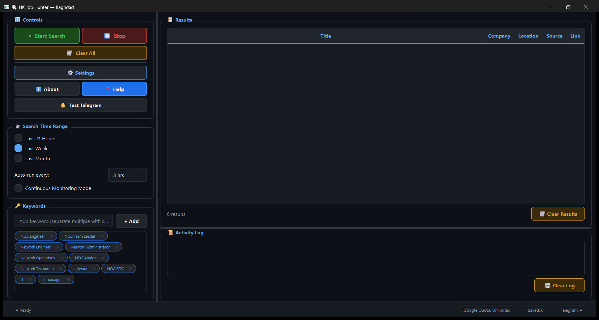

<h1 align="center">HK Job Hunter</h1>

<p align="center"><b>Finds fresh IT and network job posts and notifies you on Telegram</b></p>

<p align="center">
  
  
  
  [](https://github.com/alisadhk/hk-job-hunter/releases/latest)
</p>

---

## Overview
A PyQt6 desktop tool that searches LinkedIn jobs and posts for Baghdad/Iraq (free, no API key), removes duplicates and sends new results to your Telegram chat.

## Features
- LinkedIn guest job search and LinkedIn posts search
- Duplicate filtering between runs
- Telegram notifications
- Editable keywords, locations and search interval

## Screenshots
<p align="center"></p>

## Download and install
### Option A - Ready-to-run download (recommended)
1. Open the **[Releases page](https://github.com/alisadhk/hk-job-hunter/releases/latest)**.
2. Download the file(s) listed under **Assets**:

| File | Size |
|---|---|
| `HK-Job-Hunter-source.zip` | 0 MB |

3. Run it. 

### Option B - Run from source
Requirements: Windows 10/11 and Python 3.10+.

```bash
git clone https://github.com/alisadhk/hk-job-hunter.git
cd hk-job-hunter
python -m pip install -r requirements.txt
python main.py
```

## How to use
1. Create a Telegram bot with **@BotFather** and note its token; get your chat ID.
2. Copy config.example.py to config.py and put your token and chat ID in it.
3. Install the requirements and run `python main.py`.
4. Adjust keywords and locations in the settings tab, then press Start.

## Configuration and privacy
- config.py and the data/ folder are ignored by git, so your token and history stay private.
- The example config contains only placeholders.
- The Arabic search words in the code are intentional (Iraqi job posts).

## Build the executable yourself
```bash
python -m pip install pyinstaller
python -m PyInstaller --noconfirm hk-job-hunter.spec
```
The executable is created in the `dist/` folder.

## Notes
- Respect the terms of the sites you search.

---

<p align="center">Maintained by <a href="https://github.com/alisadhk">@alisadhk</a> - last update 2026-06-03</p>